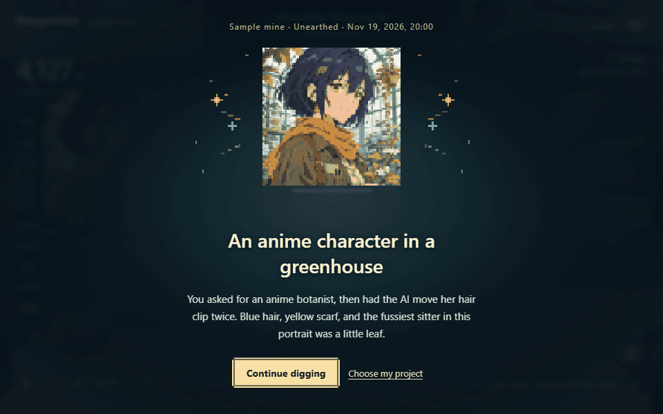
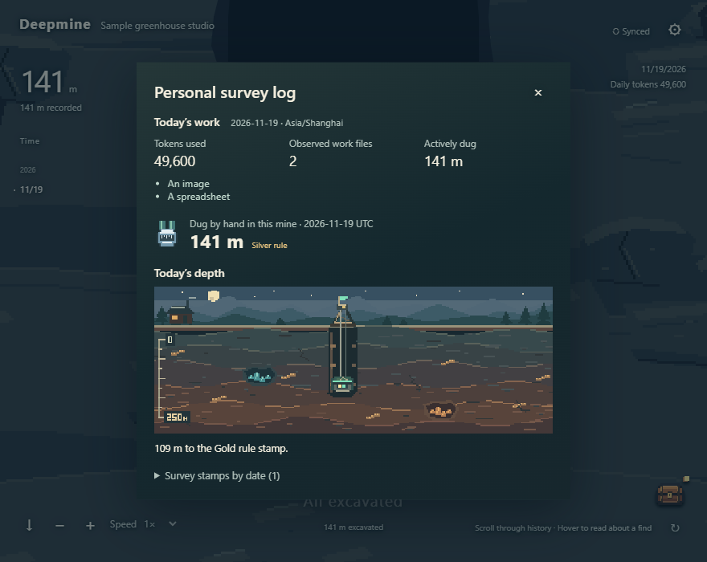

# Deepmine

**What did you make with today's tokens?** Deepmine turns a local AI project into a playable pixel-art mine. Recorded usage and work determine how deep you can dig. When the rock breaks, you can find the portrait you drew or the sound you recorded. Scroll back up the shaft a week later and they're still there.

[Download Deepmine](https://github.com/yjin94606-art/deepmine/releases/latest) · [Quick start](docs/QUICKSTART.md) · [简体中文](docs/README.zh-CN.md)



*Real gameplay from the fictional sample mine. The botanist’s leaf-shaped hair clip took two revisions to peek out from behind her bangs.* [View the discovery still](docs/demo-portrait-en.png)

## Download and play

Choose the ZIP for your system under **Assets**. Both downloads include the playable sample mine. [Get the V1 release](https://github.com/yjin94606-art/deepmine/releases/tag/v1.0.0)

| System | Download | After extracting the ZIP |
| --- | --- | --- |
| Windows x64 | `deepmine-v1.0.0-windows-x64.zip` | Double-click **Open Deepmine.cmd**. The runtime is included. |
| macOS | `deepmine-v1.0.0-source.zip` | With Node.js 20 or newer installed, double-click **Open Deepmine.command**. |
| Linux | `deepmine-v1.0.0-source.zip` | With Node.js 20 or newer installed, run `sh open-deepmine.sh` in the extracted folder. |

Choose **Try a sample mine** on the welcome screen. You can reach the first find without an account or API key. **Choose my project** takes you back to the welcome screen, where you can select a recent Codex or Claude Code project or browse to a folder where you keep your work. Leave the launcher window open while you play. [First launch, saves and upgrades](docs/QUICKSTART.md)

## Back in your own mine

**Dig until you hit something.** The drill stops when a piece of work breaks free. Inspect what you found and choose when to continue. A drawing can carry its original composition, a PCM WAV file can put its waveform on a reel-to-reel recorder, and a spreadsheet can supply the values for its own bar chart. When the source offers fewer clues, the game uses an object for the file type.

**Come back for an earlier draft.** Scroll up the shaft or pick a date. Hover over a find for a short note, or select it for details. You can rearrange finds along the excavated wall and spend coins from sold items on furnishings.

**See what you did today.** Open the archive chest and choose **Personal survey log**. In the example below, Deepmine read 49,600 tokens and two distinct work files from a fictional greenhouse project. The player drilled 141 metres. The log shows all three measurements for the project’s local day. [How survey stamps work](docs/PERSONAL-SURVEY.md#your-survey-log)



## What feeds the drill

| Source | What Deepmine can read |
| --- | --- |
| Codex and Claude Code | Project session logs with timestamps and reported token usage |
| Local Git repositories and work folders | Commits, changed files and observed project outputs |
| OpenAI, Anthropic and Gemini API calls | Usage returned by the provider through the optional local proxy |
| Other editors and tools | Per-call JSONL imports, hooks or local events supplying usage and work records |

Missing usage appears as **Unknown**. Choose one metering route per call to avoid counting the same usage twice. [Setup and supported inputs](docs/QUICKSTART.md)

## What's next

Deepmine will keep getting updates after 1.0. The focus is on how each dig feels, how reliably tools report work, and how well you can recognize what you made when it comes out of the rock. If a find looks wrong or a session is missing, tell us which tool you used and what you expected to see. [Give feedback](https://github.com/yjin94606-art/deepmine/issues) · [Follow releases](https://github.com/yjin94606-art/deepmine/releases)

## Privacy

The game opens in your browser and listens on `127.0.0.1`. Core play, project records and saved progress stay on your computer. You can play without running a cloud service.

AI-written notes and saved conversation excerpts are separate opt-ins. Generating a note shares work details with your signed-in Codex account and uses its quota. Including the creative process also shares matching discussion excerpts. Unfolding a daily treasure map contacts GitHub Trending. Optional news can contact Hacker News, and the optional API proxy contacts the provider you configure.

## Run from source

With Node.js 20 or newer, open a terminal in the extracted source folder and run the following command. The game has no npm runtime dependencies.

```sh
npm run open
```

Use `npm run doctor` to check connections, `npm run check` to check syntax and `npm test` to run the test suite. Deepmine’s code is MIT-licensed. Bundled models and runtimes retain their own licenses. [Contributing](CONTRIBUTING.md) · [MIT license](LICENSE) · [Third-party notices](vision/README.md)
