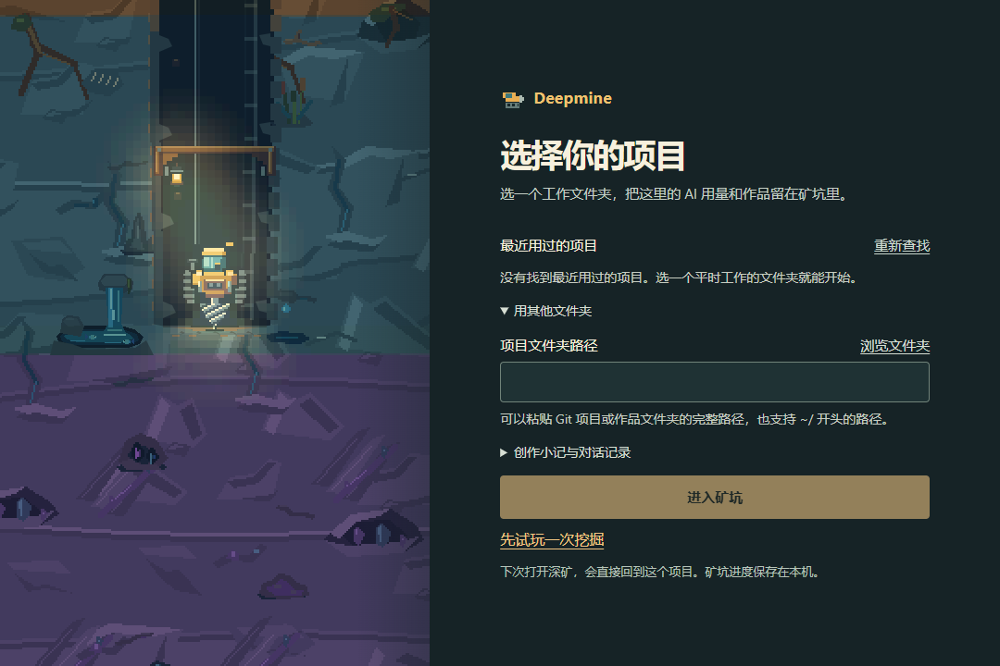

# 用本机的 Codex 开矿

## 从下载到第一次开挖

想先看看钻头挖出什么，可以在欢迎页点 **先试玩一次挖掘**。这是随包的虚构矿坑，无需选择项目。要使用自己的真实记录，再按下面的步骤连接。

1. 解压发行包。Windows x64 免安装包已包含运行环境，双击最外层的 **Open Deepmine.cmd**。macOS 使用源码包里的 **Open Deepmine.command**，Linux 运行 `sh open-deepmine.sh`。源码包需要 Node.js 20 或更新版本。
2. 浏览器会自动打开「选择你的项目」。从最近的 Codex 和 Claude Code 项目中选择，点 **进入矿坑**。想让 Codex 给物品写一段创作小记，可在「物品小记」中选「结合作品和创作过程写」。这会把对应作品的少量创作对话交给模型。也可选择只用作品内容。保存请求原话是另一项选择，原话在展开来源时出现。项目没有出现在列表里时，点 **重新查找**，或选 **用其他文件夹 → 浏览文件夹** 逐级选择，也可以直接粘贴路径。Windows 用户可在「其他磁盘」里跳到作品所在的盘符。
3. 初次读取完成后，有待挖深度就点 **开挖**。遇到作品，钻头会停下来。看完点 **继续挖掘**。以后只要打开同一个启动文件，便会回到上次的矿坑。



**退出与升级。** 使用期间保留启动窗口，退出时关掉它即可。新安装的进度保存在当前用户的数据目录，换解压目录后仍可继续。旧安装已有 `.deepmine` 时会沿用它。从旧版源码包升级到其他位置时，请带上原来的 `.deepmine`，或将 `DEEPMINE_DATA_DIR` 指向原目录。设置过 `DEEPMINE_DATA_DIR` 的用户继续使用同一个位置。

**刚开始没有用量或作品。** 在选中的项目中完成一次 Codex 工作，或把文件保存到已连接的输出目录。页面会自动同步，也可以点右下角的刷新。列表读取活动和归档日志，显示仍存在的项目。若系统没有自动打开浏览器，可点启动窗口打印的本机地址；默认端口被占用时以该窗口显示的地址为准。

## 需要手动切换项目或指定目录时

先退出当前服务，在源码目录运行

```sh
npm run connect:codex
```

输入项目编号即可保存并启动。需要自定义来源、输出目录或存档位置时，可以使用下面的选项。

使用 Windows 免安装包时，可以在解压目录打开 PowerShell，通过包内的 Node.js 修改连接。使用自定义存档的用户应沿用启动游戏时的 `DEEPMINE_DATA_DIR`。下次仍从最外层启动文件进入。

```powershell
& '.\Deepmine\runtime\node.exe' '.\Deepmine\scripts\connect-codex.cjs' --setup-only
```

**只查看可选项目**

```sh
npm run connect:codex -- --list
```

**从指定的项目读取成果**

```sh
npm run connect:codex -- --project "/path/to/my-project" --outputs "exports,images"
```

Windows 可以把路径写为 `"D:\Projects\我的项目"`。路径有空格时保留双引号。非交互终端也可使用 `--latest` 选择最新开始的会话所属项目。`--setup-only` 只保存设置，下次运行 `npm start` 会启动服务。

- **Codex 日志。** 默认查找 `CODEX_HOME`，未设置时使用当前用户主目录下的 `.codex`。自定义位置可传 `--codex-root "/path/to/codex-home"`。如果列表为空，在目标项目里完成一次本地 Codex 对话，然后重新列出项目。若软件没有把实际用量写到可读的本地日志，矿坑会显示相应的来源状态。
- **项目与工作区。** `--project` 指定 Git 和作品文件所在项目。默认只接收工作目录位于该项目内的 Codex 会话。若 Codex 从上级工作区启动，可同时传 `--scope "/path/to/workspace"`，该目录应包含项目。这个范围内其他会话也会计入用量，宜选尽量具体的目录。
- **作品文件。** 首次选择普通项目后，默认收录该项目内的文件。可以用 `--outputs "exports,art"` 只选部分目录。扫描跳过隐藏目录、依赖目录和符号链接，单次扫描有数量、体积与日期上限。选择用户主目录、磁盘根目录或 Deepmine 安装目录时，需手动指定想观察的输出目录。相同项目再次连接会保留原来的目录设置。
- **请求原话。** 默认关闭对话记忆。如果希望详情显示可核对的请求短句，可在连接时增加 `--memories`。原话以匹配该版本的生成回执为依据。没有回执时，仍可从作品本身读到内容和文件记录时间。
- **检查连接。** 在另一个终端运行 `npm run doctor`，可查看项目目录、本机 Codex 会话数量和当前来源状态。默认会寻找当前矿坑实际使用的端口。也可以用 `npm run doctor -- --port 4210` 检查指定端口。项目与正在运行的服务不一致时，退出旧服务，再以新配置启动。
- **自定义存档。** 如果手动设置 `DEEPMINE_DATA_DIR`，启动、设置与诊断时都使用同一位置。启动器也会识别解压目录中已有的旧版 `.deepmine/config.json`。每位用户的账户、日志与矿坑保留在自己的电脑上。

