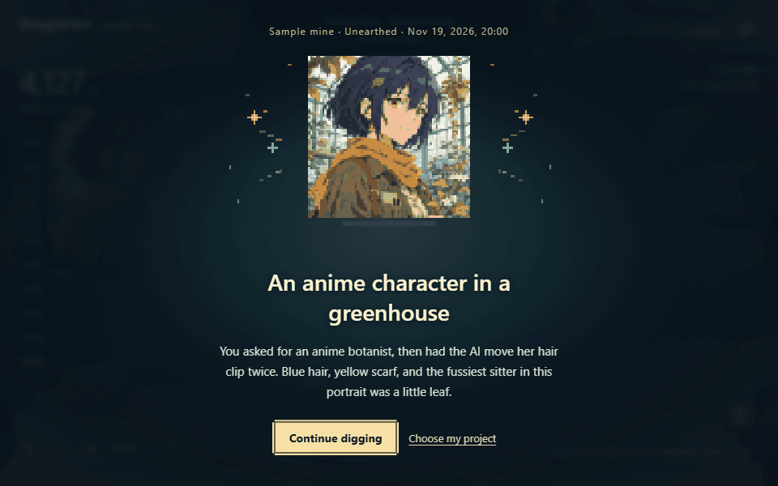

# Deepmine 1.1.0

**[Play the browser sample](https://yjin94606-art.github.io/deepmine/)** · **[Download for Windows x64](https://github.com/yjin94606-art/deepmine/releases/download/v1.1.0/deepmine-v1.1.0-windows-x64-setup.exe)** · **[macOS / Linux](https://github.com/yjin94606-art/deepmine/releases/download/v1.1.0/deepmine-v1.1.0-source.zip)**

What did you make with all those tokens? Deepmine turns a local AI project into a pixel-art mine. The usage and work your tools record give the drill more ground to cover. When the rock breaks, you discover something you actually made.

The clip comes from the playable sample. The drill stops for a portrait of a botanist in a yellow scarf. Open her note and you'll find out why it took two revisions to get that leaf-shaped hair clip into view. Keep digging, then scroll back up. Her portrait is still there.

## Dig into your own project

Pick a local Codex or Claude Code project, or browse to a folder where you keep your work. A drawing keeps its colors and composition. A PCM WAV recording leaves its waveform in the rock. Open the archive chest after a session to see the tokens your tools reported, the files observed that day, and how far you dug.

## Download and play

| Platform | Release asset | First launch |
| --- | --- | --- |
| Windows x64 | [Offline installer](https://github.com/yjin94606-art/deepmine/releases/download/v1.1.0/deepmine-v1.1.0-windows-x64-setup.exe) | Open Setup once. Launch Deepmine from the Start menu next time. |
| Windows x64 portable | [Windows ZIP](https://github.com/yjin94606-art/deepmine/releases/download/v1.1.0/deepmine-v1.1.0-windows-x64.zip) | Extract the ZIP and double-click **Open Deepmine.cmd**. Node.js is included. |
| macOS | [Source ZIP](https://github.com/yjin94606-art/deepmine/releases/download/v1.1.0/deepmine-v1.1.0-source.zip) | With Node.js 20 or newer installed, extract the ZIP and open **Open Deepmine.command**. |
| Linux | [Source ZIP](https://github.com/yjin94606-art/deepmine/releases/download/v1.1.0/deepmine-v1.1.0-source.zip) | With Node.js 20 or newer installed, extract the ZIP and run `sh open-deepmine.sh`. |

Choose **Try a sample mine** to play before connecting a project. The sample is fictional and needs no account or API key. Your own mine is saved on your computer. Sending material to an AI for a written note is optional.

## What changed in 1.1

- Open the offline Windows installer and go straight to the project picker. The sample is within reach on a phone-sized screen.
- Switch between your projects from inside the mine. Each keeps its depth, discoveries and settings.
- The drill waits for you at a new find, even if you open the same mine in another browser or close it overnight.
- When several related files share a find, you can inspect the individual works in its detail view.

## After 1.0

Development continues with the feel of each dig, compatibility with local tools, and how individual finds look in the mine. If the game misses a piece of work or you have an idea for how it could appear underground, we'd love to hear about it. [Share feedback](https://github.com/yjin94606-art/deepmine/issues) · [See new releases](https://github.com/yjin94606-art/deepmine/releases)
